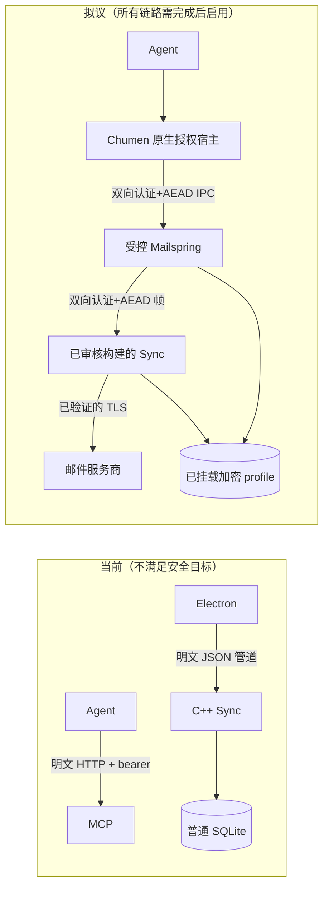
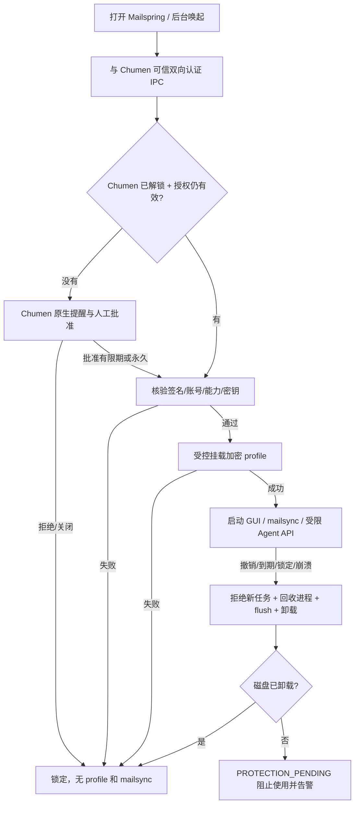

# Mailspring：全数据加密、传输加密及 Chumen 托管授权（macOS）

**状态：DESIGN / SOURCE_REVIEW；尚未修改产品源码，NOT_RUN。2026-11-08。**

本需求来源于用户“把 Mailspring 的所有数据进行加密，通信也需要加密；授权逻辑交给 Chumen 原生提醒，批准后才能使用，并可永久授权”的明确变更。本仓负责 **Mailspring 的全部持久数据与各通信通道**，不是只给邮件 MCP 加新授权标识。Chumen 负责原生授权提示、Keychain/密钥释放控制、应用生命周期与 Agent 精确权限。两个仓库都必须改。

配套 Chumen 权威 V2 设计：[mailspring-encrypted-security-20261108.zh.md](https://github.com/buildHelpers/Chumen/blob/task/20261108-0114-mailspring-auth/docs/plans/mailspring-encrypted-security-20261108.zh.md)（Draft [PR #56](https://github.com/buildHelpers/Chumen/pull/56)）。旧“只保护 Agent 访问 Mailspring MCP”方案已被 V2 取代。

固定基线：本仓 `master` `6218cb1f80ca5f8a903a1ffa5d45e68a3497f813`；Chumen `master` `943cb581175642078d792adbbeeb8b3f2b2c9a02`。当前不是已安装/运行的任何版本的验收报告。

## 1. 实际存在的存储路径与待核查边界

| 现有代码／事实 | 待加密的数据 | 不能仅凭源码断言的部分 |
| --- | --- | --- |
| `app/src/browser/main.js` 通过 `setupConfigDir` 创建默认配置根，并 `app.setPath('userData', configDirPath)` | Electron userData、应用配置、登录缓存、插件默认状态 | WebView 分区、Chrome 子缓存、crash dump、系统临时目录是否全部受此路径影响，需 macOS fs_usage / FSEvents 做真实写点清单 |
| `app/src/browser/config-persistence-manager.ts` 直接读写 `config.json` | 非凭据设置、账户元数据、MCP 设置/令牌等 | `chmod 0700` 只是访问权限，不是数据加密 |
| `app/src/flux/stores/database-store.ts` 用 `better-sqlite3` 打开 `edgehill.db`，设置 WAL 模式 | 邮件正文、索引、账户、联系人、草稿和 `edgehill.db-wal`／`edgehill.db-shm` | 文件仍是普通 SQLite 读取路径，不能只加密主 db 留明文 WAL |
| `app/src/key-manager.ts` 使用 Electron `safeStorage` 保存邮箱凭据 | OAuth/IMAP/SMTP 凭据和令牌 | 安全存储凭据**不覆盖邮箱数据库、配置、附件、索引和日志** |
| `app/src/mailsync-process.ts` 传递 `CONFIG_DIR_PATH` 给子进程 | 独立原生 mailsync 产生的数据库、附件、临时文件、后台同步状态 | 原生二进制可能另外写入临时根/日志，需核对 [Foundry376/Mailspring-Sync](https://github.com/Foundry376/Mailspring-Sync) 的**准确构建与实际文件路径** |
| `app/src/browser/application.ts` 处理 DB reset、`edgehill.db-wal`、`edgehill.db-shm` | 异常恢复与重建数据库的旧/新副本 | 重建不得在卷外生成裸文件；失败后不得回退默认主目录 |
| `app/internal_packages/mcp-server/` 存在动态令牌、直接 HTTP 服务和审计记录 | Agent 工具结果、审计、配置信息及 MCP 会话数据 | 原令牌在普通配置里且本机端口仍可直连；Chumen 代理前必须先消除绕过 |

**必须补做运行时目录勘察**：邮件本体、附件、EML 导入/导出、下载、头像和远程图片、搜索全文索引、拼写与翻译缓存、第三方插件写点、PDF/打印、通知、临时草稿、localStorage、IndexedDB、Service Worker、Cookies、DevTools、编译缓存、Updater、Sentry/Crashpad、stdout/stderr、OS 缓存/日志、备份及迁移中间产物。记录哪些目录必须在加密卷，哪些要关闭或脱敏，哪些属于系统无法保证的边界。**未核对的写点不可报“已完成所有数据加密”。**

## 2. 选定实现路线和不可降级规则

macOS 首版采用 **受 Chumen 授权后挂载的 APFS AES-256 加密 profile**（加密磁盘映像），把全部 Mailspring 应用控制的敏感持久数据定向到一个私有受保护的 profile 根。Mailspring GUI、mailsync、所有插件和后台任务共享该目录；未解锁时对 profile 的任何读取/写入必须拒绝、不能自动初始化明文配置或空白账户。

Chumen 加密运行空间 [PR #54](https://github.com/buildHelpers/Chumen/pull/54) 仍是 Draft，存在路径身份/TOCTOU、超时进程回收及冷恢复缺口；**不得直接作为现成可信生产卷**。在这些缺口修复和 Mac 独立验证前，本仓只做隔离假数据实验/代码审阅，不迁移真实邮箱。

静态数据保护要求：
- profile 与主要缓存、所有附件、所有数据库、WAL/SHM、崩溃/日志、临时和导出中间文件都在加密文件系统内；不允许静默创建 `~/Library/...` 其他明文缓存。
- App 默认启动路径在**同步引擎、数据库、插件及 MCP 初始化之前**验证 Chumen 授权与 vault 可用；错误/超时/断连严格 fail-closed。没有 Chumen 不得切换回原来未受控的 profile。
- 密钥由 Chumen 可信 Mac owner 在受限 Keychain 包装；每个 Mailspring profile 用独立高熵密钥；不得暴露于 Agent、CLI argv、进程环境、日志、请求 URL、配置或插件。解除授权/锁定时停止后台同步、关闭数据库句柄后卸载并擦除临时密钥。若卷仍 Busy，状态应为 `PROTECTION_PENDING` 而非“已锁定”。
- 存储加密≠挂载期间进程隔离：同一 macOS 用户的恶意程序有机会看到已挂载明文。要求挂载时强隔离需独立 sandbox/VM 方案与风险审查，不能用权限或一个单独的 PIN 冒充。
- 如采用 SQLCipher + 附件逐文件 AEAD 等替代路线，必须同步改原生引擎写入端、所有 SQLite reader、插件/缓存以及数据恢复，不能遗漏 `-wal`。跨平台不随本次 macOS 改造自动改动。

## 3. 所有重要通信链路都加密

| 链路 | 当前证据 | 目标契约 |
| --- | --- | --- |
| Chumen ↔ Mailspring | 未实现统一可信桥接 | **可信代码签名/审计令牌绑定身份 + 加密认证 IPC**：优先原生 Unix/XPC + 经过审查的 X25519/KDF/AEAD 帧，双向身份确认、序号、防重放、会话过期；仅文件权限或回环 HTTP 不通过 |
| Agent ↔ Mailspring MCP | `mcp-http-server.ts` 明文 `http.createServer` 监听 `127.0.0.1`，bearer 验证 | Chumen 托管模式禁用旧 Mailspring 直连与 Claude/Codex 自动原始 MCP 注册；只接受 Chumen 授权入口，使用固定的本机认证加密传输（可选 TLS 1.3 mTLS + pinned cert），不得暴露通用 `tools/call` 透传 |
| Electron ↔ 原生 C++ mailsync | `mailsync-process.ts` 现经 stdin/stdout 发送账户 JSON、身份、任务和邮件增量 | **双方都实现会话级 AEAD 认证加密帧**，握手/密钥协商/序号/超时/失败取消/最大帧/零化必须单测；要取得并重编确切的 C++ 引擎源码，不能只改 JS 包装 |
| 邮件服务器（IMAP/SMTP/HTTPS/日历/联系人） | 使用独立原生 mailsync/服务配置 | 每个渠道强制 TLS 证书校验和无明文降级，不容忍失败 `STARTTLS` 回退；需要真实 provider 协议负例和证书失败测试 |

说明：TLS 保护传输中的连接，并不代表发送的邮件本身端到端加密。PGP、S/MIME 如需要，另立需求。操作系统的休眠内存、交换区、截屏、通知、外部备份及用户自行导出文件属于明确限制而非本仓保证“百分之百”。

### 当前通信与拟议方案

## 4. Chumen 原生授权（必须覆盖 App 启动及 Agent）

- **默认没有权限**。首次 Mailspring 受控启动，Chumen 原生窗口显示可信进程/签名、profile、账号、动作（打开、读信、草稿、发送、管理、后台同步）、用途、期限；明确 **允许一次 / 限时 / 永久允许 / 拒绝**。PIN/Touch ID 由 Chumen 已有机制处理，邮件进程不能替它做审批。
- Chumen CapabilityBoundary 的 `duration_seconds=0` 已支持**永久 grant**，但目前并未把 Mailspring 程序、密钥和业务入口连接起来。必须按程序签名、构建/哈希、profile、账号、能力固定绑定。永久 ≠ 永不锁定；机器重启、Chumen 锁定/解锁、应用签名变更和权限变更都要重新核验对应安全状态，任何人工撤销即时拒绝。
- 永久允许 App 使用或读信**不包括**无限制发信、删除、外发、后台明文挂载。默认发信每封都要可信内容快照的人审，不能使用旧 `read-write-send` 直接绕过。以后如提供永久发送须以固定收件人、频率、限额单独制定策略/显式审批。
- 无 Chumen、拒绝、撤销、签名不符、Keychain 不可用时 Mailspring **锁定界面、不得打开 DB、不得启动 sync、不得对外监听/发送邮件**。已有 Mailspring MCP bearer 不得再成为另一个未授权入口。
- 用户主动允许长期无 UI 后台同步时，必须另授 `mail.background-sync`，显示卷保持挂载造成的暴露，并可一键撤销；永久普通授权默认不继承后台同步权。

### 开启 / 锁定 / 恢复

## 5. 无损迁移与动态写点验收

1. **实验目录**：先用纯测试数据运行 GUI + sync 替身/受控测试账户，遍历所有 macOS 实际写点；列出遗漏的 Electron 子进程缓存、临时目录、crash handler、更新流程。所有真实邮箱凭据禁止进入 fixture。
2. **迁移计划**：在应用完全退出后关闭全部 SQLite/WAL 句柄、checkpoint、快照/签名确认、创建加密备份；形成可复核文件目录与哈希清单。任何操作不能破坏用户现有邮件/草稿/登录配置。
3. **迁移执行**：加密容器安全创建、复制、校验、先验证恢复再激活受控根。失败/断电/磁盘空间不足保持原数据可恢复，不回退启动明文；旧目录不会自动删除，需用户明确决定清理及承认系统快照可能保留明文。
4. **回滚与升级**：安装/更新时确认签名、配置身份和 Chumen grant；换证书/可执行摘要触发受控再批准。回滚版本不能误读高版本加密数据库、也不能把密钥/卷挂到不受信任 app。
5. **数据泄露与锁定测试**：未挂载/锁定时检查外侧磁盘不可直接 SQLite 查询、字符串扫描不含测试信件、WAL/SHM/缓存无残留；使用未授权进程/旧 MCP 令牌均被拒绝；忙卸载、掉电、进程崩溃、令牌轮换均 fail-closed。测试结果须与业务功能测试分开记录。
6. **收发功能**：验证合法授权下搜索、草稿、收发、附件、重启恢复、同步一致性和大库性能；缺授权不得产生远端网络副作用，不确定发送不得自动重试；性能对比只报真实运行结果。

## 6. 拆分与验收状态

| 工作项 | 责任方 | 当前状态 |
| --- | --- | --- |
| 全写点清单与静态威胁模型 | Mailspring | `SOURCE_REVIEW` + `PLAN`；未跑 macOS 动态追踪 |
| 数据加密卷、启动 gate、无损迁移 | Mailspring + Chumen | `NOT_RUN`；Chumen Vault [PR #54](https://github.com/buildHelpers/Chumen/pull/54) 仍 `BLOCKED` |
| Chumen 批准/永久 grant/密钥释放 | Chumen | 现有独立授权组件 `SOURCE_REVIEW`，本集成 `NOT_RUN` |
| 原生 C++ sync IPC AEAD / provider TLS | Mailspring + 对应 Sync 引擎来源 | `NOT_RUN`，需核对实际二进制 provenance |
| 禁用旧 MCP 直连、受控加密工具入口 | Mailspring + Chumen 插件 | `NOT_RUN` |
| 完整 Mac 构建/安装/真实用户验收 | 两仓 | `NOT_RUN` |

完成时报告必须区分 `DESIGN`、`MOCK`、`REAL`、`FAILED`、`BLOCKED`、`NOT_RUN`，并分别证明固定提交、文件加密、通信加密、授权、发行签名与用户态运行。**不要因为某条链路使用 Keychain/TLS 或 APFS 就宣称全部邮件已经加密。**

受控模式和持久授权的实际实施仍须遵守 Chumen 仓库的明确实施确认门槛。当前只提交需求和源码核查，不触及真实邮件、配置或安装。
