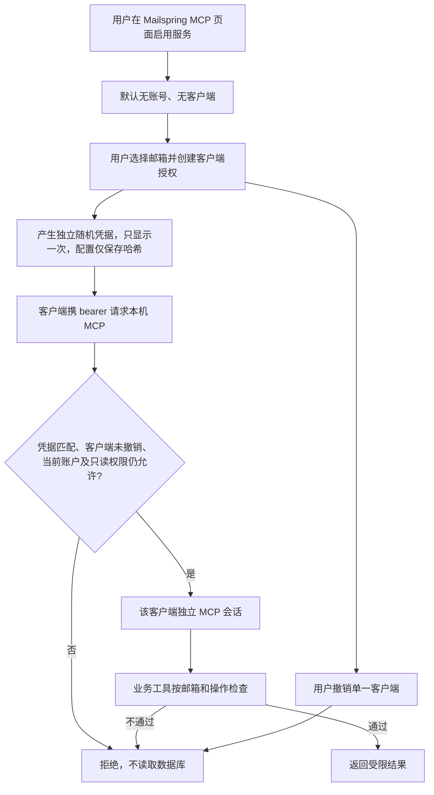
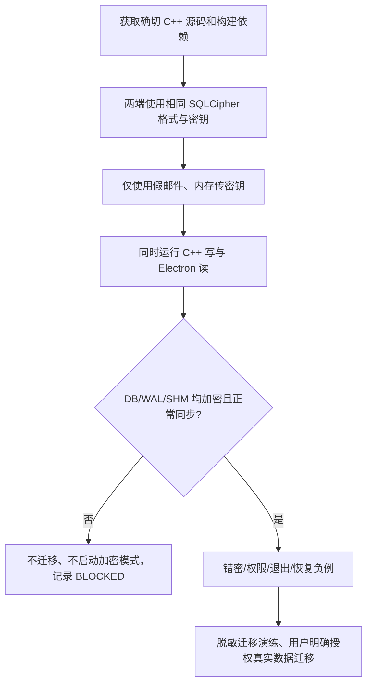

# 核心数据库加密与 MCP 独立授权：最小可用范围

日期：2026-11-08。**本文件是本轮 V3 实施边界，取代同仓库此前“全数据/全通信同时做”的 V2 排期**。

## 用户明确收敛的范围

- **P0 核心数据库**：`edgehill.db` 及 `edgehill.db-wal`、`edgehill.db-shm` 使用 SQLCipher 兼容的加密格式。先只做核心，不扩展附件、缓存、打印/日志、PGP/S/MIME 和全 IPC 加密。
- **P0 MCP 独立授权**：旧共享 bearer 禁止直接读取邮件。每个 MCP 客户端使用独立强随机凭据、服务端仅保存哈希，明确选择获准邮箱；未授权默认拒绝，独立撤销，不允许因连接成功获得所有邮箱。先支持**只读**，发信/删除等后续另经人审。
- **P1 Chumen 原生审批**：后续接入 Chumen 的可信身份/原生弹窗及永久授权 owner，不能把 Mailspring 配置页里的凭据称作 Chumen 已批准。MCP 独立令牌只是第一道最小授权，不是 OS 级应用身份认证。
- 用户原有邮件和设置不能因升级被删除或自动密文迁移；未验证的加密功能不得自动启用，也不得回退明文并声称已加密。

## 源码核查与真实阻塞

| 组件 | 当前事实 | 最小可行改动 |
| --- | --- | --- |
| Electron `app/src/flux/stores/database-store.ts` | `better-sqlite3` 普通 SQLite 只读打开 `edgehill.db` | SQLCipher 构建兼容读者、密钥初始化在任何查询之前、读失败拒绝；须防止无密钥时误读已有明文库 |
| `mailsync` 子模块 | 锁定 `Foundry376/Mailspring-Sync@8681eae1d217d993e4d4dc7de17ae8b91fc3da49`；`MailSync` C++ 使用 SQLiteCpp 与随源码编译的 sqlite3 | 需要可维护的专用同步引擎分支/来源、SQLCipher 编译与同一密钥接口；**只改 Electron 会导致 DB 读取与 C++ 写入不一致，不可声称已实现加密** |
| 迁移 | 原库含真实邮件与草稿 | 用假库验证 `sqlcipher_export`、WAL checkpoint、崩溃恢复、错密拒绝与回滚；迁移必须用户确认且先做可恢复备份，不自动删除原文件 |
| HTTP MCP | `mcp-http-server.ts` 仅校验单一 `core.mcp.token`，所有调用者共享同等权限；未配置 `enabledAccounts` 时全部邮箱可见 | 逐客户端令牌/账户范围、默认空权限、访问前再校验有效授权、会话不能跨客户端使用、撤销使旧连接失效 |
| 旧客户端配置 | Claude/Codex 快捷接入复用明文共享 token | 禁止旧的自动配置/共享 token，逐客户端新凭据手动交付一次；旧凭据立即不被服务器接受 |

## MVP 授权交互

**独立授权契约**：
1. 不接受 `core.mcp.token` 旧单令牌；只有配置页显式生成、随机 256-bit、持久仅存 SHA-256 哈希的客户端凭据有效。
2. 绑定客户端 ID、显示名、明确邮箱 ID 列表、`read-only` 能力与过期时间（可选永久），每次调用前复核当前授权；会话同一客户端持有且撤权无效。
3. 零客户端／零账户／错误令牌／空值／篡改／旧连接／跨客户端 session／已过期／已撤销均拒绝。
4. 客户端自报名称不能证明进程身份，凭据泄露者仍可冒充；Chumen 原生审批和应用身份是后续独立工作，不夸大。
5. 旧 Claude/Codex 自动安装不能继续把一份共享令牌写到用户配置；不要自动重启客户端或清理用户旧配置。
6. 测试涵盖拒绝与允许，`MCP tools/list` 也需要身份检查；读附件属于独立敏感能力，最小版不授权附件路径/资源读取。

## 核心数据库实施门槛

MVP 不是在普通 SQLite 文件外套一个临时加密脚本：必须是**持续读写皆加密、故障后依旧加密**。在未取得可编译的 C++ SQLCipher 引擎、Electron SQLCipher 原生依赖和真实 Mac 运行证据前，数据库项保持 `BLOCKED`，不能对用户真实邮件做迁移。

## 本次可交付与状态定义

- `SOURCE_REVIEW`：两端数据库实现、子模块固定 SHA、旧 MCP 共享令牌及账户默认放行已经复核。
- `PLANNED`：此最小需求及安全边界。
- `NOT_RUN`：实际 SQLCipher 双端编译、密钥注入、真实 Mac 数据迁移及安装；禁止把纯静态测试写作它们的通过结果。
- 后续源码提交/测试在 PR #1 追加；Chumen PR #56 作为未来原生审批接口，不将其与 MCP 单独授权混淆。

本轮用户指令“先做最小化、把核心进行加密、MCP 独立授权”视为 V3 的实施确认。允许在**独立分支**修复本仓 MCP 安全边界及准备不破坏用户库的加密引擎接入；不允许直接在真实邮箱上试验、合并主分支或部署。
