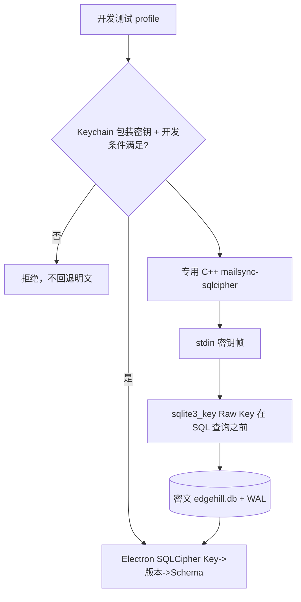

# 核心 SQLCipher 数据库接入：2026-11-08 阶段证据

状态：**代码已提交 / macOS 原生双端构建 NOT_RUN / 真实数据库加密尚未验收**。关联 [Mailspring PR #1](https://github.com/SharedBench/Mailspring/pull/1) 和 [Chumen Issue #66](https://github.com/buildHelpers/Chumen/issues/66)。

## 已完成的实际代码改动

| 位置 | 责任与保护 |
| --- | --- |
| [C++ 固定来源构建变换](../../scripts/sqlcipher/prepare-sync-source.mjs) | 验证 `Foundry376/Mailspring-Sync@8681eae` 干净的子模块；复制到独立编译目录并修改 MailStore、main 和 Xcode；移除普通 `sqlite3.c` 的编译，链接 `libsqlcipher`。不提交/修改第三方上游。 |
| [macOS 编译脚本](../../scripts/sqlcipher/build-sync-macos.sh) | 只创建无签名的本地开发产物；不会打包、安装或改写真实邮箱。 |
| C++ MailStore 变换 | stdin 的 `MCPDB1:` 密钥帧先于任何 MailStore 构造；数据库连接在准备事务前以 `sqlite3_key` 设置密钥；拒绝普通 SQLite 文件头并验证 `cipher_version` 和 schema。**C API 使用 SQLCipher `x'<64hex>'` 原始密钥字面量，不把裸 32 bytes 当作 KDF 口令**。 |
| [Mac 密钥包装读取](../../app/src/services/mail-database-security.ts) | 只在 Mac 开发模式 + 显式测试开关时允许从 Electron `safeStorage` 取已包装的测试 Key；生产版未接入 Chumen 原生密钥发放。 |
| [数据库读取](../../app/src/flux/stores/database-store.ts) | 加密模式在任何其他查询前调用 SQLCipher key，并验证驱动与密钥，拒绝明文 SQLite 文件；异常时不执行原版重建/删除操作，不回退普通 SQLite。加密模式禁止没有密钥的后台数据库代理。 |
| [引擎启动](../../app/src/mailsync-process.ts) / [账户同步](../../app/src/flux/mailsync-bridge.ts) | 声明加密的 profile 不会启动普通 mailsync；只有拿到测试密钥才选择 `mailsync-sqlcipher` 并通过 stdin 首帧传密钥；原始缓存重建在加密模式被禁止。 |
| [主进程恢复入口](../../app/src/browser/application.ts) | `start()` 的迁移失败不能向受保护数据库提供“Rebuild”；`_resetDatabaseAndRelaunch` 和最底层 `_deleteDatabase` 均拒绝操作受保护或身份未知的库。即使配置缺失，但磁盘上还留有 `edgehill.db` / WAL / SHM，或现存数据库文件头不能验证为普通 SQLite，也拒绝自动删除。 |
| [假数据库互通探针](../../scripts/sqlcipher/probe.mjs) | 临时空 profile 的 C++ SQLCipher 写库、Node `better-sqlite3` 加密读取、随机文件头和错密拒绝；只作用于新建的临时测试目录。 |
| [脚本测试](../../scripts/sqlcipher/prepare-sync-source.test.mjs) | 正/反向验证转换的精确锚点、密钥设置顺序、普通 SQLite C 源移除及 drift 拒绝。 |

## 最小数据流



## 已执行的验证与不能宣称通过的检查

- **REAL — Node 本地非模型验证**：`node --check` 已检验脚本语法；`node --test` 三项源码变换隔离测试 3/3 通过，环境为 Linux/Node 22。只证明脚本逻辑和遇到非预期上游代码时拒绝修改，**不证明生成的 C++ 可以通过 Xcode 编译**。
- **NOT_RUN — macOS**：Xcode SQLCipher 构建、对应 SQLCipher native `better-sqlite3` 在 Electron 44 的 ABI/代码签名及互读运行、实际同步、WAL/SHM 加密检测、错密/崩溃恢复、真实数据库迁移。
- **REAL — 静态安全核对**：已核对 Mailspring 主进程此前的 `start→migrate→Rebuild→_deleteDatabase` 可能删除 `edgehill.db` 和 WAL/SHM；现在三个入口都被保护策略拒绝，相关代码提交在同 PR。**保护策略实际运行负例 NOT_RUN**，暂不将静态核对冒充运行验证。
- **BLOCKED — 生产启动**：主进程 `MailsyncProcess.migrate()` 发生在 `ConfigPersistenceManager` 初始化之前；当前不存在可信的 Chumen grant+Keychain 密钥启动/迁移协调机制。因此加密模式只能保持关闭，开发者单独假数据探针不等于实际 Mailspring 已能以加密模式启动。
- **NOT_IMPLEMENTED — 生产链**：现有用户的数据库迁移、密钥首次配发和恢复、Chumen 原生审批/签名身份、主进程启动时的受保护数据库迁移次序、打包器加入并签名 `mailsync-sqlcipher`。当前从未修改或读取真实邮箱数据，且仍默认关闭加密。
- **MCP**：本 PR 早前的逐客户端只读授权仍在同一分支，尚无真实 macOS 审批/客户端测试，不等于已连接 Chumen。
- **兼容风险**：当前加密路径为显式开发探针，而非已发布功能。加密/明文 DB 不可混用；无法运行时拒绝而非暗中生成普通数据库；加密 DB 的内存和 OS 缓存/附件未被本轮覆盖。

## macOS 本机验收入口（全程使用单独测试 checkout）

```sh
git submodule update --init mailsync
node --test scripts/sqlcipher/prepare-sync-source.test.mjs
SQLCIPHER_PREFIX="$(brew --prefix sqlcipher)" bash scripts/sqlcipher/build-sync-macos.sh
# 以下只在对 better-sqlite3 完成 SQLCipher 专用原生编译之后执行：
node scripts/sqlcipher/probe.mjs "$(pwd)/.build/sqlcipher-sync/bin/mailsync"
```

只有固定 C++ 产物和真实 Electron 加密读库通过，并完成 Chumen 身份/Keychain 安全审查与迁移回滚测试，才能讨论启用到真实邮箱。未验证就不合主、不安装、不部署、不自动触发 GitHub 托管 CI。
